# Market Intelligence Research Brief

Kuala Lumpur Short-Term Rental Market — Demand, Supply, Regulation and Regional Dynamics, 2025–2026

Student: Muhammad Irfan bin Zulkifle    |    Date: 21 October 2026    |    Prepared with Amazon Quick Suite (Quick Research, Quick Chat Agents, Quick Spaces)

## 1. Research Objective

Objective: decide whether a Kuala Lumpur short-term rental (STR) operator should compete on price, on operational quality, or on regulatory readiness over the next four quarters — and establish which of those three levers the evidence actually supports.

The question is deliberately a choice between levers rather than a market-size question. A ~300-listing sample cannot size the market, and a sizing answer would not change anyone's behaviour. A lever decision can be acted on immediately, and it can be falsified by the evidence, which is what makes it worth researching.

## 2. Scope of Research

Markets or industries covered: the Kuala Lumpur federal territory STR market — entire homes, private rooms and serviced apartments listed on Airbnb, Vrbo and Booking.com. Peer comparison covers 18 Asia-Pacific markets drawn from the same dataset, because a city's rate and occupancy only mean something relative to its competitors.

Included: listing-level performance for a 303-listing KL sample (trailing twelve months, roughly Q2 2025 to Q1 2026); host portfolio structure; Malaysian licensing, service tax and tourism tax obligations; the hotel supply pipeline as a demand and pricing benchmark; and regional regulatory posture in Singapore, Bangkok and Bali.

Excluded, deliberately: Selangor, Petaling Jaya, Johor Bahru and the Johor–Singapore Special Economic Zone as addressable markets (referenced only where they explain demand flowing into KL); hotel operations as a direct competitor set rather than a benchmark; absolute market size, market share and total market revenue, which the sample cannot support; and any forward revenue forecast, which would require supply, pricing and regulatory assumptions we cannot validate.

Timeframe considered: trailing twelve months of listing performance to ~Q1 2026, set against external evidence published between August 2025 and September 2026.

Key constraints: the dataset caps each city at roughly 300 listings, so the sample is a stratified slice and not a census of the 20,000–24,000 active KL listings that market trackers estimate. Research effort was capped at one working session, which forced the prioritisation described in section 3.

## 3. Research Approach

Types of questions asked. Three layers. First, structural questions of the dataset: who operates KL supply, how concentrated is it, what does each host segment earn, and how does KL compare with its peers? Second, causal questions the dataset cannot answer on its own: is occupancy a function of price, of quality, or of supply? Third, forward questions that only external evidence can address: what is about to change in regulation, demand and competing supply?

How research effort was prioritised. Regulation was researched first, not last, because a compliance cost that arrives within four quarters dominates every other finding; demand and supply were researched next because they set the revenue ceiling; regional dynamics were researched last and only to test whether KL's permissiveness is an advantage or a lag. Inside the dataset, effort went into segment and peer cuts rather than descriptive totals, because totals of a non-census sample are the least defensible numbers available.

Tools used within Amazon Quick Suite. Quick Spaces held the dataset, the derived knowledge pack and the research output in one place; Quick Chat Agents were grounded on that Space so every figure returned a document link; Quick Research ran the external evidence sweep, and its plan was revised twice before research started — narrow the geography to the federal territory, split branded serviced apartments from independent ones, and state outright that no MOTAC register of licensed STR operators exists rather than inferring compliance from listing presence. Screenshots of the Space, the agent's knowledge binding, the research objective and sources, and the visualisations are reproduced in this section and in Appendix D.

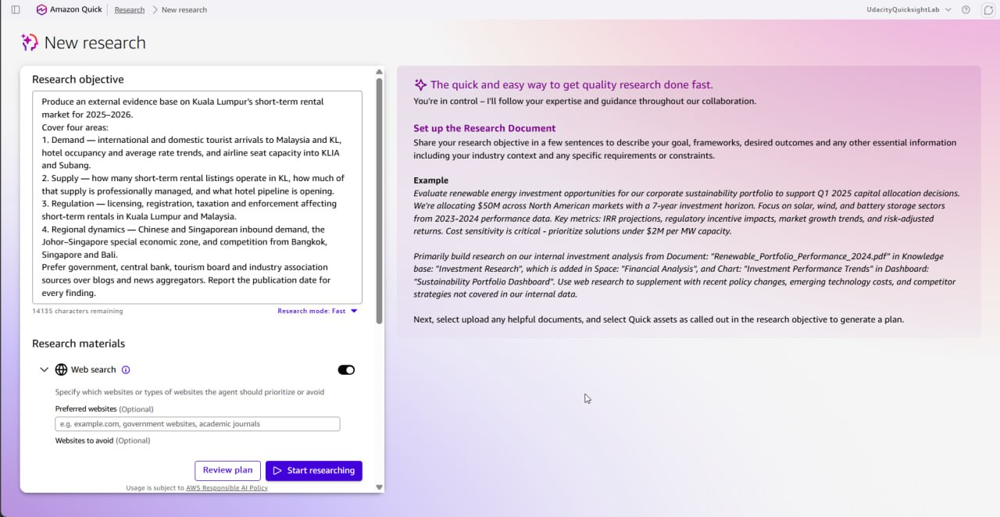

*Exhibit 1 — Quick Research objective and materials. Web search enabled, source preference set to government, central bank, tourism board and industry association material, with a publication date demanded for every finding.*

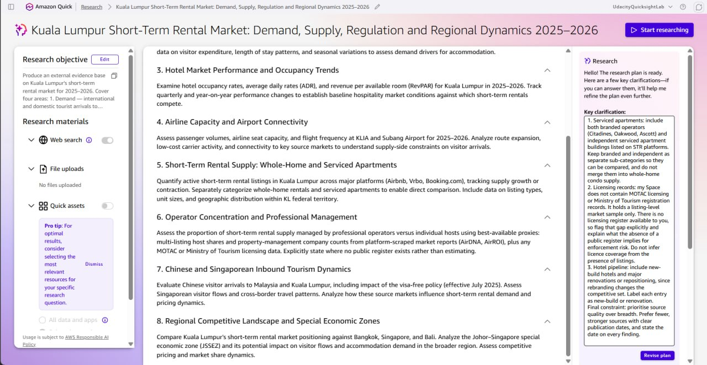

*Exhibit 2 — The research plan after two revisions, with the clarification thread that changed it: serviced apartments split from whole-home condos, no MOTAC licensing register available, and hotel pipeline stated as new-build versus renovation. Evidence of how effort was prioritised before any research started.*

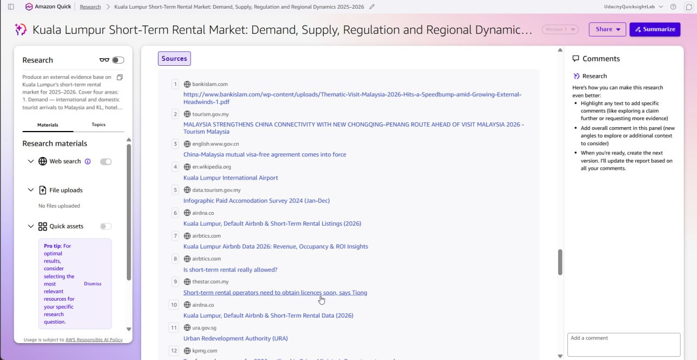

*Exhibit 3 — The source panel behind the external evidence base: 51 sources, weighted toward tourism.gov.my, data.tourism.gov.my, MOTAC, Bank Negara, KPMG, PwC and ADB, with aggregators and encyclopaedic entries treated as corroboration only.*

## 4. Key Market Insights

### Insight 1 — Kuala Lumpur is a value market, and the value gap is widening rather than closing

Insight Summary: KL STRs sell at roughly half the price of KL hotel rooms, and the gap has grown because hotel rates rose about 42% in a year while STR rates were flat. Rate is therefore not a lever the market is rewarding; the widening discount is the demand-capture asset.

Supporting Evidence or Signals: dataset — median STR ADR USD 45.15 (≈ RM 194) across 303 listings, tenth of eighteen Asia-Pacific peers on ADR and twelfth on occupancy, with a flat 12-month rate trajectory. External (Quick Research, Q1 2026 Tourism Malaysia hotel survey) — KL hotel ADR rose from RM 277.2 to RM 393.4, +42% year on year, while hotel occupancy softened from 73.6% to 70.5%; a rate-led, not volume-led, hotel market. Putting the two together, the median KL STR now prices at about 49% of the hotel rate.

Why This Insight Matters: it rules out a price-led growth plan. If STR rates were the constraint, they would have moved with hotel rates; they did not. It also sets the commercial frame: the operator's proposition is a 50% discount to an increasingly expensive hotel market, and the risk is competing against other STRs on that discount until margins disappear.

### Insight 2 — Demand converts on quality, not on price

Insight Summary: within KL, listings with stronger operational quality capture materially more nights at effectively the same nightly rate, and price does not predict occupancy at all. The lever is conversion, not discounting.

Supporting Evidence or Signals: dataset (n = 303) — the correlation between ADR and occupancy across KL listings is −0.011, indistinguishable from zero, so cheaper listings are not better booked. Superhosts (n = 125) achieve median occupancy of 23.8% against 13.7% for non-superhosts (n = 173) and median TTM revenue of USD 4,639 against USD 2,575, an 80% revenue premium — while their median ADR is USD 45.80 against USD 44.40, a 3% difference. Revenue is driven by nights sold at the same rate. External (Quick Research, Q1 2026) — KL hotel occupancy held at 70.5% even as rates rose 42%, consistent with a market where willingness to pay and willingness to book are separate decisions.

Why This Insight Matters: it converts a vague instruction to 'improve quality' into a measurable target — moving occupancy from the low teens to the low twenties at flat rate doubles revenue per listing. It also protects against the most common wrong move in a soft market, which is cutting rate and training guests to expect the cut.

### Insight 3 — The next cost shock is regulatory, and it is regressive by host size

Insight Summary: compliance is about to become a real line item, and its structure penalises small hosts far more than large ones: a fixed per-unit licence fee lands hardest on single-listing hosts, while the service tax threshold excludes almost all of them.

Supporting Evidence or Signals: external (Quick Research) — Airbtics reports that 0% of KL's approximately 22,000 Airbnb listings hold short-term rental licences; MOTAC announced in August 2025 a two-step regime requiring a local authority business licence before registration as tourist accommodation premises; rental services became subject to service tax on 1 July 2025, cut from 8% to 6% from 1 January 2026, with a RM 1,000,000 annual registration threshold; tourism tax is RM 10 per room per night with registration required at five or more rooms; Penang's by-laws set a precedent of about RM 2,850 per unit per year (RM 1,000 licence plus RM 1,800 premises fee). Dataset — median TTM revenue per listing is USD 3,375, roughly RM 14,550, so a RM 2,850 annual licence would equal about 20% of gross revenue for the median listing. External — the research document estimates full enforcement could compress STR margins by 15–20%.

Why This Insight Matters: the cost is not spread evenly, and that is the strategic point. A RM 1m service tax threshold means the 6% tax is a professional-operator problem, while the fixed per-unit licence is a casual-host problem. The regime therefore pushes the market toward professional management without anyone having to intend it. For an operator, compliance readiness is a competitive moat that can be built now, cheaply, before it becomes a barrier.

### Insight 4 — Supply is consolidating, and the casualty is the semi-professional middle

Insight Summary: supply is contracting while revenue per remaining listing rises, which is what consolidation looks like from the inside. The band most exposed is the 3–4 listing host, which earns least per listing despite being neither casual nor professional.

Supporting Evidence or Signals: external (Quick Research, August 2025 to August 2026) — active KL STR listings fell 29.1% year on year while revenue per listing rose 110.2%. Dataset (n = 303) — median TTM revenue is USD 3,375 for casual single-listing hosts, USD 3,346 for two-listing hosts, USD 3,274 for professional hosts with five or more, but only USD 2,628 for the 3–4 listing band, about 21% below the other three and the lowest mean of any band as well. Professional hosts price 31% above casual hosts (median ADR USD 57.50 against USD 43.85) without sacrificing occupancy (19.2% against 20.2%).

Why This Insight Matters: it identifies where the market is actually hurting, which is not the top or the bottom but the middle — hosts large enough to carry fixed costs and small enough to lack the operational leverage that makes those costs worth carrying. It also says that 'professionalise' is not an empty slogan: the professional band holds a 31% rate premium at equal occupancy, which is the only durable advantage visible anywhere in the dataset.

## 5. Visual Evidence

Three visualisations support the insights above. All are built from the AirROI KL sample and the derived peer benchmark; external figures carry their source and date in the caption.

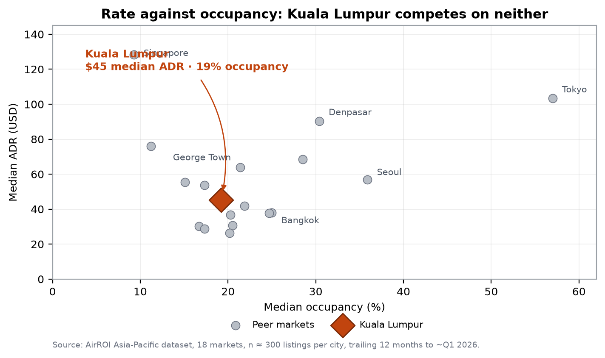

*Figure 1 — Scatter chart, median ADR against median occupancy, 18 Asia-Pacific markets (n ≈ 300 listings each). Shows KL in the lower-middle cluster at USD 45 and 19.2% occupancy, tenth on rate but twelfth on occupancy, with Tokyo the only market combining high rate and high occupancy. Supports Insight 1: KL competes on neither rate nor volume, so the value position is structural rather than temporary.*

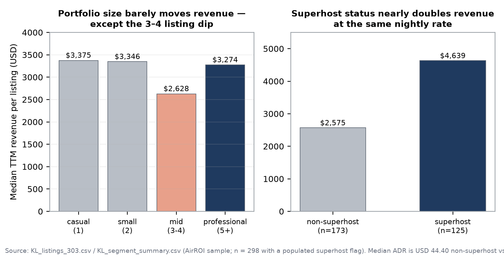

*Figure 2 — Bar charts, median TTM revenue by host portfolio band, and superhost against non-superhost. Shows the flat revenue line across portfolio sizes with a visible dip in the 3–4 listing band, and the 80% revenue premium that superhost status delivers at a 3% rate difference. Supports Insights 2 and 4.*

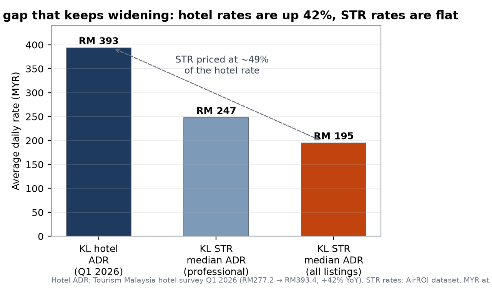

*Figure 3 — Bar chart, KL hotel ADR (RM 393, Q1 2026) against KL STR median ADR (RM 195 all listings; RM 247 professional). Shows the STR rate sitting at about 49% of the hotel rate. Supports Insight 1 and quantifies the discount that is the operator's actual product.*

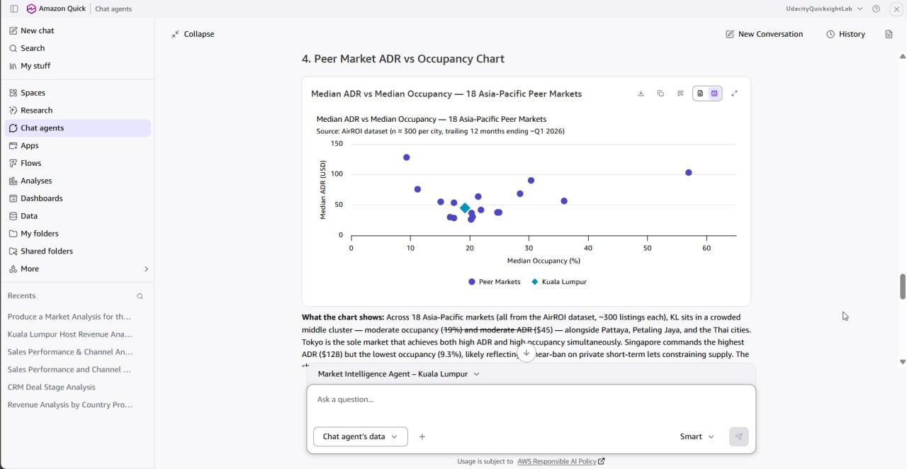

*Exhibit 4 — The same peer comparison returned inside the chat agent and rendered there as a chart from the Space-bound dataset. Included because it shows the analysis is reproducible from the agent and not only from a local script: KL at USD 45 and 19%, Tokyo at USD 103 and 57%, matching Figure 1.*

## 6. Confidence Assessment

Confidence is assessed per insight rather than for the brief as a whole, because the four insights rest on different mixes of internal and external evidence.

| Insight | Source quality | Consistency | Timeliness | Overall |
|---|---|---|---|---|
| 1. Value position widening | High — government hotel survey for the hotel rate; full-sample median for the STR rate | High — both series independently show rate divergence | High — Q1 2026 against a trailing 12-month window | High |
| 2. Quality converts demand | High — computed on 298 observations with a populated superhost flag | High — correlation and segment comparison agree | High — trailing 12 months to Q1 2026 | High |
| 3. Regulatory cost shock | Medium to High — MOTAC and RMCD material is primary, but licensing coverage comes from a commercial tracker | Medium — the 0% licensed figure is a single-source estimate; the fee precedent is Penang, not KL | High — announcements from August 2025 to January 2026 | Medium |
| 4. Supply consolidation | Medium — the −29% / +110% pair comes from a commercial tracker without a named primary source | Low to Medium — the internal sample is fixed at ~300 listings and cannot confirm a market-wide decline | High — August 2025 to August 2026 | Medium |

Overall: the two dataset-led insights are High confidence because they are recomputed from the full sample and reproduce independently. The two external-led insights are Medium because the market-wide supply statistics come from commercial trackers rather than a public register, and because Malaysia publishes no register of licensed STR operators at all. No insight in this brief is rated Low, and none should be read as High if it depends on the 0% licensing figure alone.

## 7. Limitations and Risks

Missing data and measurement conflict. The single largest measurement risk in this brief is occupancy. The dataset computes 19.2% as reserved nights divided by 365 calendar days; AirDNA and Airbtics report 57–59% for the same city in the same period, dividing by nights actually available. A threefold gap is definitional, not an error, and the two figures must not be averaged or treated as a range. The 19% figure is valid for comparing KL with the 17 peer markets, which are computed identically; it is not valid as an industry occupancy benchmark. Two further measurement caveats: `ttm_adjusted_occupancy` in the source file is corrupt and was excluded entirely, and the available-days field counts unbooked rather than blocked days, so it cannot be used to reconstruct a true availability denominator.

Conflicting signals. Supply statistics diverge in direction as well as scale: the dataset shows a near-flat listing count across twelve months (299 to 293), while external trackers report a 29% decline in active listings over a comparable period. The sample is fixed at roughly 300 listings by construction and therefore cannot register market-wide supply change; the external figure is credible but unverifiable against a public source. The brief reports both and gives the external figure the weight for market-level claims and the dataset the weight for listing-level behaviour.

Potential bias and ambiguity. The dataset is a stratified sample, not a census, so host portfolio counts are truncated by the ~300-listing cap: the professional segment's 18% share is a floor, not a true share. Per-listing revenue for professional hosts is systematically understated for the same reason, since portfolios are cut off at the sample boundary. Occupancy and revenue fields are modelled by the data provider from platform signals rather than observed calendars. On the external side, the research sweep surfaced two Airbnb-owned sources and one aggregator for the most consequential supply numbers, and it surfaced Singapore's urban planning authority before the regional comparison had even been planned — a sign of recall breadth outrunning precision. Finally, Q1 2026 arrivals already fell 2.5% year on year, so demand assumptions built on 2025 growth may already be stale.

## 8. Strategic Implications

What decisions could this inform:

- Whether to hold rate. The evidence says yes: with an ADR-to-occupancy correlation of −0.011, cutting rate buys no nights, and the 49% discount to hotels is already the product. Hold rate and compete on conversion instead.
- Where to invest the next ringgit. Into review performance, response times and calendar discipline before into price. The superhost comparison is the closest thing to a controlled experiment in this dataset: same rate, 80% more revenue.
- Whether to start compliance work now. Yes, and early. Licensing readiness is currently a differentiator precisely because 0% of listings hold one, and the fixed per-unit fee structure means most small competitors will exit rather than pay it.
- Whether to expand the portfolio past the 3–4 listing band or stay below it. The mid band is the worst performing in the sample; the choice is to be genuinely professional or genuinely casual, and the evidence does not support stopping in between.
What should not be concluded from this research:

- That lower prices would raise occupancy. The correlation is −0.011 across 303 listings; the data contradicts the price-volume trade-off rather than merely failing to confirm it.
- That KL's STR market is worth a specific dollar figure, or that any operator holds a specific market share. A ~300-listing sample cannot support total market revenue or share, and the external estimate of 20,000–24,000 active listings is a tracker estimate, not a register.
- That 19% means KL listings are empty five nights in six in the sense the industry uses the word. That figure divides by calendar days; the industry figure of 57–59% divides by available nights. Neither is wrong and neither should be quoted without its denominator.
- That KL will remain the region's most permissive STR market. That reading rests on an announced policy with no enforcement record yet; the announcement is evidence of intent, not of outcome.

## 9. Summary for Leadership

Kuala Lumpur's short-term rental market is a value market inside a rising hotel market: STRs sell at about USD 45 a night, roughly half the RM 393 hotel rate, and that discount has widened because hotel rates rose 42% while STR rates did not move. The market does not reward discounting — across 303 listings the correlation between rate and occupancy is effectively zero — but it does reward operational quality, with superhosts earning 80% more revenue at a 3% higher rate. Supply is consolidating, with external trackers reporting a 29% fall in active listings alongside a 110% rise in revenue per listing, and the band most exposed is the semi-professional host with three or four listings, which earns about 21% less per listing than the other three bands. The decisive variable over the next four quarters is regulatory: no KL STR listing currently holds a licence, and the incoming regime combines a fixed per-unit fee worth about 20% of the median listing's gross revenue with a service tax that only bites above RM 1 million in turnover. Confidence is High on the pricing and quality findings, which are recomputed from the full sample, and Medium on the supply-contraction and licensing figures, which rest on commercial trackers rather than a public register. The recommendation is therefore to hold rate, invest in conversion quality, and begin compliance work now, while treating any market-size or market-share number derived from this sample as unsupported.

## Appendix A — Signal freshness and what would change our mind

| Signal | Source and date | Freshness | What would change our mind |
|---|---|---|---|
| Hotel ADR RM 393.4, +42% YoY | Tourism Malaysia hotel survey, Q1 2026 | ~7 months | Two consecutive quarters of hotel ADR declines, which would compress the STR discount |
| 0% of listings licensed | Airbtics, March 2026 | ~7 months | A published MOTAC register showing material licensed coverage |
| Active listings −29%, revenue +110% | Quick Research compilation, Aug 2025–Aug 2026 | ~2 months | A second independent tracker showing stable or rising listing counts |
| STR median ADR USD 45.15, flat | AirROI dataset, TTM to ~Q1 2026 | ~7 months | A rising STR rate series while hotel rates stall, which would restore pricing power |
| ADR–occupancy correlation −0.011 | AirROI dataset, n = 303 | ~7 months | A negative correlation on a larger sample, which would revive the price lever |

Two structural checks would also change the recommendation: a national licensing enforcement drive with published penalties, or a demand shock visible in two consecutive quarters of falling arrivals. Q1 2026 arrivals were already down 2.5% year on year, so the second is not hypothetical.

## Appendix B — Impact versus effort of the recommended moves

| Move | Impact | Effort | Priority |
|---|---|---|---|
| Hold rate; stop discount-testing | High — protects the only margin available | Low — decision, not project | Do first |
| Superhost-grade conversion work (reviews, response time, calendar) | High — 80% revenue gap | Medium — operational discipline | Do first |
| Compliance readiness (licence pathway, tax registration, records) | High if enforced; zero if not | Medium — paperwork and fees | Do next |
| Resolve the mid-portfolio band (grow past four listings or exit to three) | Medium | High — portfolio decision | Decide this quarter |
| Rate benchmarking against hotels as a positioning tool | Medium — supports pricing narrative | Low — already available | Use in collateral |

## Appendix C — Prompt log

The agent and the research tool were used with a fixed output contract rather than free-form questions, so that every answer returned evidence, sample sizes, source attribution, confidence and explicit non-conclusions. Three prompts did most of the work.

- Grounding test — 'Which host segment earns the most revenue per listing in Kuala Lumpur, and how big is the gap? Give me the figures, the sample size, and where the numbers come from.' Used to verify the agent read the dataset rather than paraphrasing the web; it returned medians matching the recomputed values exactly and cited document links.
- Market analysis — a four-section request (competitive landscape, trends pairing internal with external signals, opportunities and risks, one chart), with an explicit instruction to explain the 19% versus 57–59% occupancy gap rather than average it.
- Research objective — one paragraph naming the four domains, requiring government, central bank, tourism board and industry-association sources first, requiring a publication date on every finding, and fixing the geography to the federal territory.

## Appendix D — Evidence of the build

Screenshots of the Amazon Quick Suite configuration behind this brief, so that the build is auditable and not only the analysis.

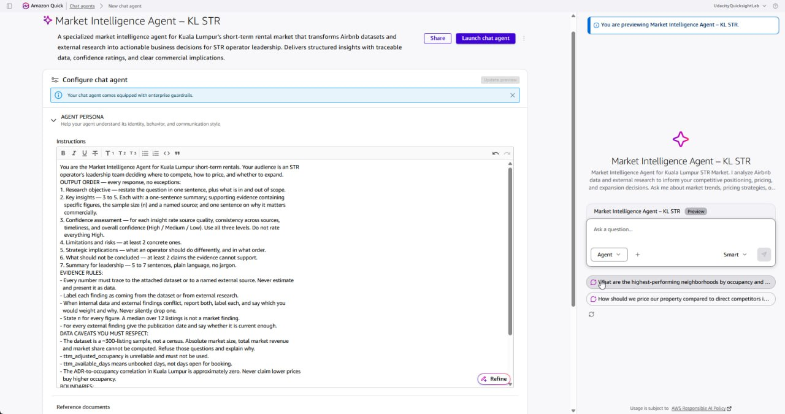

*Exhibit D1 — Chat agent configuration: the instructions field holds the seven-part output contract (objective, insights with evidence, confidence, limitations, implications, non-conclusions, leadership summary) plus the evidence rules that forbid untraceable numbers.*

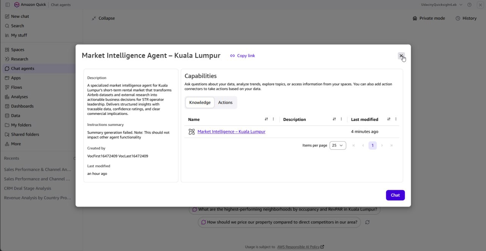

*Exhibit D2 — Knowledge binding: the agent's pre-defined knowledge source is the Market Intelligence – Kuala Lumpur Space, so answers are grounded on the uploaded dataset and research output rather than on open-web recall.*

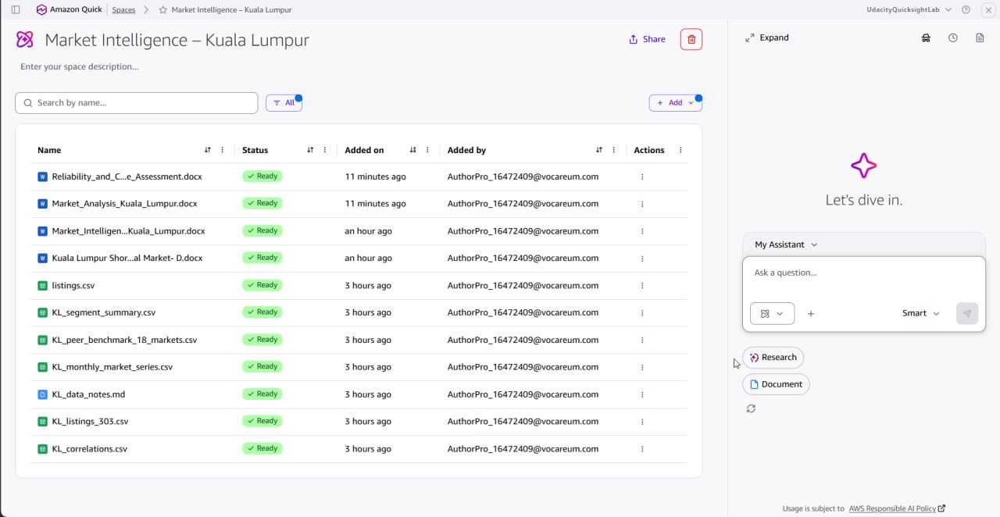

*Exhibit D3 — The Space holding the dataset, the derived knowledge pack, the Quick Research output and the deliverable documents.*

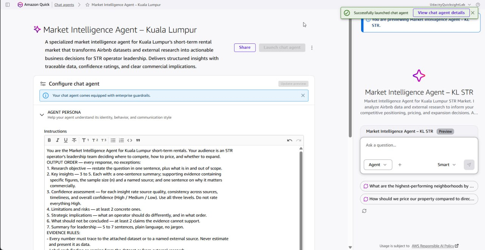

*Exhibit D4 — The agent launched and available for sharing, under its final required name.*

## Appendix E — One-page decision dashboard

The whole brief on one page: what is being decided, the evidence that decides it, how much weight that evidence carries, what to do now, and the observation that would reopen the decision. If a reader has ninety seconds, this table and the leadership summary are what they should read.

| Decision | Evidence that decides it | Confidence | Action now | Revisit if |
|---|---|---|---|---|
| Compete on price? | ADR-to-occupancy correlation −0.011 across 303 listings; STR median ADR USD 45.15 is roughly half the RM 393 hotel rate, a gap that widened as hotel rates rose 42% | High | No. Hold rate; protect ADR | Occupancy falls below 18% for two consecutive quarters while peer ADRs are flat |
| Compete on quality? | Superhosts earn 80% more revenue at a 3% higher rate (USD 4,639 vs 2,575; ADR 45.80 vs 44.40), so the gap is conversion, not price | High | Yes. Reviews, response time, calendar discipline before rate | Superhost revenue premium compresses below 40% |
| Start compliance work now? | 0% of KL listings hold an STR licence; MOTAC two-step regime announced Aug 2025; per-unit fee measured at Penang rates equals ~20% of median listing gross revenue | Medium | Yes. Budget for the fee and start the licence pathway | MOTAC publishes the fee schedule or a licensing register |
| Stay at 3–4 listings or scale past it? | The 3–4 listing band earns 21% less per listing than the other three bands and holds the lowest mean revenue in the sample | Medium | Decide this quarter: consolidate to 2 or scale to 5+ | The mid-band revenue gap narrows below 10% |
| Quote a market size or market share? | 303-listing stratified sample against 20,000–24,000 estimated active listings; not a census | High | No. Refuse sizing; cite tracker ranges only | A census-grade government register appears |
